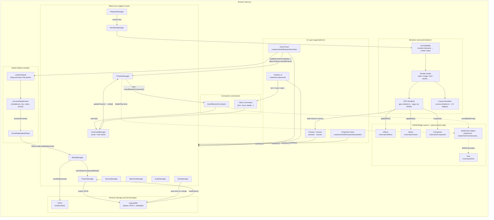

# Web Editor Architecture

High-level map of how the major subsystems in `apps/web/` fit together.

## Layer summary

| Layer | Location | Responsibility |
|---|---|---|
| **UI** | `src/components/`, `src/timeline/components/`, `src/preview/` | Rendering panels, drag-and-drop, property controls |
| **EditorCore** | `src/core/` | Singleton that owns all manager instances; sole source of truth for editor state |
| **Commands** | `src/commands/` | Every undoable mutation — dispatched through `CommandManager` |
| **Media pipeline** | `src/media/` | File ingestion, codec detection via `mediabunny`, thumbnail generation |
| **Renderer** | `src/services/renderer/` | Builds a node tree from the active scene and draws frames via GPU or 2-D canvas |
| **Storage** | `src/services/storage/` | IndexedDB (project JSON) + OPFS (raw media blobs); versioned migrations |
| **WASM bridge** | `src/wasm/`, `opencut-wasm` pkg | TypeScript wrappers for `MediaTime` and Rust compositing/effects/masks |
| **Rust crates** | `rust/crates/` | GPU pipelines (wgpu), compositor, effects, masks, time math |

## Key invariants

- **`EditorCore` is a singleton.** All UI reads state through `useEditor()` which subscribes via `useSyncExternalStore`.
- **All mutations go through a `Command`.** The `CommandManager` maintains the undo/redo stack; never mutate manager state directly.
- **`MediaTime` is integer ticks, not seconds.** Construct only via helpers in `@/wasm` (`mediaTime`, `mediaTimeFromSeconds`, `roundMediaTime`).
- **Storage migrations are additive-only.** Never remove or rename persisted fields — only add new ones alongside the old.
- **First visual element triggers project setup.** `InsertElementCommand` auto-sets canvas size and FPS from the asset when the timeline is empty.
